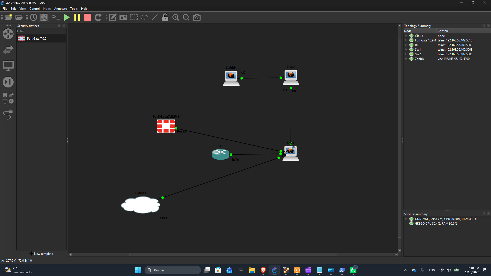
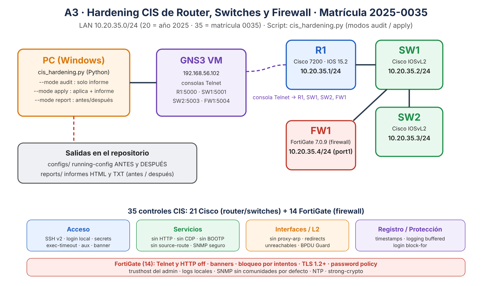
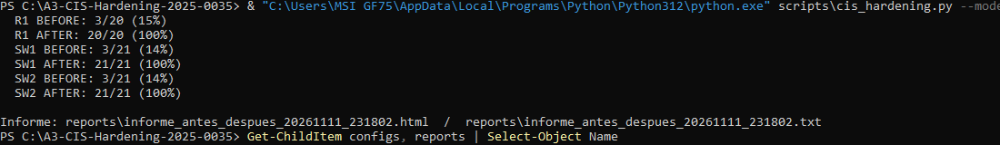
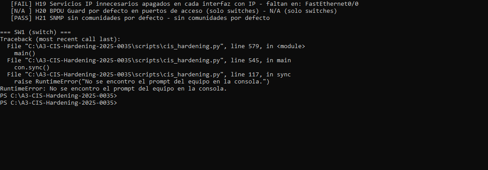
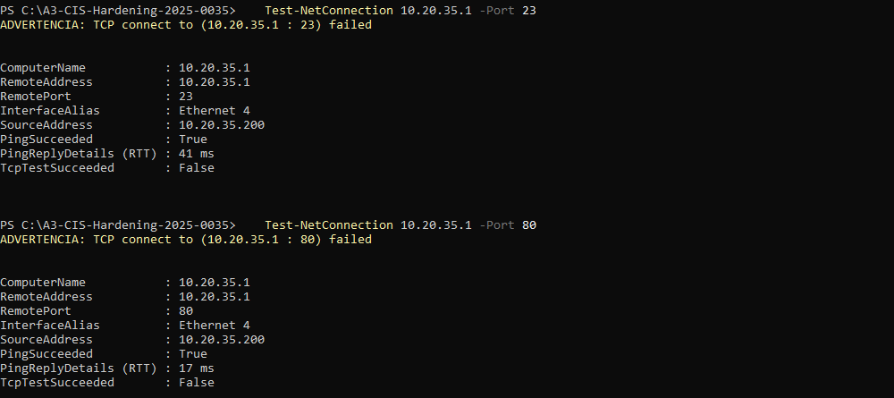
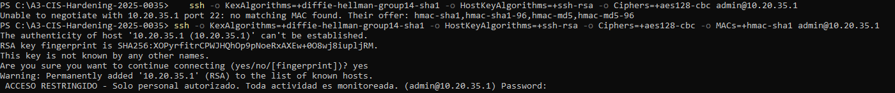
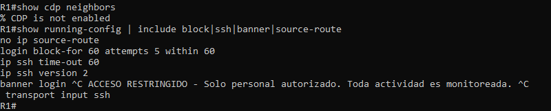

# A3 · Hardening CIS de Router y Switches Cisco (con script de auditoría y aplicación)

> ▶️ **Video de la demostración:** https://youtu.be/vAURe5kAKiw

**Estudiante:** Gregorys Morel Duluc · **Matrícula:** 2025-0035 · **Materia:** Seguridad de Redes · **ITLA**

---

## 1. Propósito del laboratorio

Reducir la **superficie de ataque** de los equipos de red de una topología (un router y dos switches Cisco) aplicando recomendaciones de **hardening** basadas en el **CIS Benchmark para Cisco IOS**, y demostrar que funcionan.

El laboratorio incluye:

1. Un **análisis** de los equipos contra las recomendaciones CIS elegidas.
2. La **aplicación** de esas recomendaciones y su **documentación** (qué se aplicó y por qué).
3. **Pruebas** que demuestran que las recomendaciones están activas.
4. Un **script automatizado** (`scripts/cis_hardening.py`) que escanea los equipos y puede:
   - crear un **informe sin aplicar ninguna regla** (`--mode audit`), o
   - **aplicar las reglas y generar un informe posterior** (`--mode apply`).

## 2. Topología y direccionamiento (basado en la matrícula)

**Topología en GNS3:**



**Diagrama lógico (flujo del script y capas de hardening):**



El direccionamiento se deriva de la matrícula **2025-0035**: red **10.20.35.0/24** (`20` = año 2025 y `35` = número de matrícula 0035).

| Equipo | Modelo | Rol | IP de gestión | Consola GNS3 |
|---|---|---|---|---|
| R1 | Cisco 7200 (IOS 15.2) | Router | 10.20.35.1/24 (Fa0/0) | 192.168.56.102:5000 |
| SW1 | Cisco IOSvL2 | Switch | 10.20.35.2/24 (Vlan1) | 192.168.56.102:5001 |
| SW2 | Cisco IOSvL2 | Switch | 10.20.35.3/24 (Vlan1) | 192.168.56.102:5003 |

Entorno: GNS3 2.2 + GNS3 VM (VirtualBox). La misma red de la práctica anterior, ahora endurecida.

## 3. Herramienta de análisis

La herramienta de análisis es el script propio **`scripts/cis_hardening.py`** (Python 3, sin dependencias externas). Se conecta por la consola Telnet de GNS3, descarga el `running-config` de cada equipo y evalúa **21 controles** tomados de las recomendaciones del **CIS Cisco IOS Benchmark** (los nombres de cada control corresponden a las recomendaciones del benchmark; la numeración de sección puede variar según la versión del documento). Genera informes HTML y TXT y guarda el `running-config` de antes y de después.

> La herramienta oficial del CIS para este análisis es CIS-CAT Pro (requiere membresía). Aquí se usa un script propio que implementa los controles seleccionados, para poder automatizar tanto la auditoría como la remediación.

## 4. Recomendaciones CIS aplicadas y por qué

| ID | Recomendación CIS | Qué se configura | Por qué se aplica |
|---|---|---|---|
| H01 | Enable 'service password-encryption' | Cifra las contrasenas en texto claro del running-config | Evita que alguien que vea la configuracion (hombro, respaldo, TFTP) lea contrasenas. |
| H02 | Set 'enable secret' | Contrasena de modo privilegiado con hash (enable secret) | 'enable secret' guarda un hash, 'enable password' es reversible. |
| H03 | Set 'username secret' for all local users | Usuarios locales con secret (hash) y sin contrasenas en texto claro | El usuario local de respaldo debe almacenarse con hash. |
| H04 | Set 'transport input ssh' for 'line vty' connections | Solo SSH en las lineas vty (sin Telnet) | Telnet envia usuario y contrasena en texto claro; SSH cifra la sesion. |
| H05 | Set 'login local' (authentication) for 'line vty' | Las vty exigen usuario y contrasena locales | Sin autenticacion de usuario cualquiera que llegue a la vty entra. |
| H06 | Set 'exec-timeout' to <= 10 minutes (con 0 / aux 0 / vty) | Cierra sesiones inactivas (maximo 10 min) | Una sesion abierta y olvidada es una puerta abierta a la configuracion. |
| H07 | Set 'no exec' for 'line aux 0' | Deshabilita el puerto auxiliar | El puerto AUX es un acceso fisico/modem que casi nadie vigila. |
| H08 | Set 'ip domain-name' | Dominio configurado (requisito para generar claves SSH) | SSH necesita hostname y dominio para crear la clave RSA del equipo. |
| H09 | Set version 2 for 'ip ssh version' | SSH version 2 (clave RSA creada si no existe) | SSHv1 tiene fallas criptograficas conocidas. |
| H10 | Set 'ip ssh time-out' <= 60 and 'ip ssh authentication-retries' <= 3 | Tiempo de negociacion y reintentos SSH limitados | Reduce el margen para ataques de fuerza bruta por SSH. |
| H11 | Set the 'banner-text' for 'banner login' | Aviso legal al conectarse | Da base legal para actuar contra accesos no autorizados. |
| H12 | Set 'no ip http server' / 'no ip http secure-server' | Servidor web del equipo deshabilitado | Reduce la superficie de ataque: la administracion se hace por SSH. |
| H13 | Set 'no ip source-route' | Deshabilita el enrutamiento de origen (source routing) | Permite a un atacante dictar la ruta de sus paquetes y saltarse controles. |
| H14 | Set 'no ip bootp server' | Servicio BOOTP deshabilitado | Servicio obsoleto que no se usa; menos servicios, menos riesgo. |
| H15 | Set 'no cdp run' | CDP deshabilitado globalmente | CDP revela modelo, IOS e IPs del equipo a cualquier vecino. |
| H16 | Set 'service timestamps log datetime' | Logs con fecha y hora | Sin hora exacta no se pueden correlacionar eventos en una investigacion. |
| H17 | Set 'logging buffered' (severity level) | Registro local de eventos en memoria | Conserva evidencia local de lo ocurrido en el equipo. |
| H18 | Enable login protection ('login block-for') | Bloqueo temporal tras intentos fallidos de login | Frena ataques de adivinacion de contrasenas contra las vty. |
| H19 | Set 'no ip proxy-arp', 'no ip redirects', 'no ip unreachables' on L3 interfaces | Servicios IP innecesarios apagados en cada interfaz con IP | Evitan fuga de informacion y abuso (proxy ARP, redirects, ICMP unreachable). |
| H20 | Enable 'spanning-tree portfast bpduguard default' | BPDU Guard por defecto en puertos de acceso (solo switches) | Un switch pirata conectado a un puerto de acceso no puede alterar el STP. |
| H21 | Do not use default SNMP community strings (public/private) | SNMP sin comunidades por defecto | 'public' y 'private' son lo primero que prueba un atacante. |

Comandos aplicados (resumen): `service password-encryption`, `enable secret`, `username admin privilege 15 secret`, `line vty` con `transport input ssh` + `login local` + `exec-timeout 5 0`, `line aux 0` con `no exec`, `ip domain-name`, `crypto key generate rsa modulus 2048`, `ip ssh version 2`, `ip ssh time-out 60`, `ip ssh authentication-retries 3`, `banner login`, `no ip http server`, `no ip http secure-server`, `no ip source-route`, `no ip bootp server`, `no cdp run`, `service timestamps log datetime msec`, `logging buffered`, `login block-for 60 attempts 5 within 60`, `no ip proxy-arp` / `no ip redirects` / `no ip unreachables` en interfaces con IP y `spanning-tree portfast bpduguard default` en los switches.

## 5. Uso del script

```powershell
# 1) Solo informe, SIN aplicar ninguna regla
python scripts\cis_hardening.py --mode audit

# 2) Aplicar las reglas que fallan y generar el informe posterior (antes / después)
python scripts\cis_hardening.py --mode apply

# 3) Regenerar el informe antes/después a partir de los running-config guardados (no toca los equipos)
python scripts\cis_hardening.py --mode report

# Opciones
python scripts\cis_hardening.py --mode audit --devices R1,SW1 --host 192.168.56.102 --ports R1=5000,SW1=5001,SW2=5003
```

Salidas: `configs/<EQUIPO>-running-config-ANTES.txt` y `-DESPUES.txt`, e informes en `reports/` (HTML y TXT).

## 6. Resultados (antes / después)

| Equipo | Controles cumplidos ANTES | Controles cumplidos DESPUÉS |
|---|---|---|
| R1 | 3/20 (15 %) | 20/20 (100 %) |
| SW1 | 3/21 (14 %) | 21/21 (100 %) |
| SW2 | 3/21 (14 %) | 21/21 (100 %) |

Salida del script en modo `--mode report` (antes → después de cada equipo):



Auditoría inicial de R1 (modo `--mode audit`, sin aplicar nada): 3 de 20 controles cumplidos.



Los informes completos están en [`reports/`](reports/) y los `running-config` en [`configs/`](configs/).

## 7. Pruebas de las recomendaciones

Telnet bloqueado (solo SSH), servidor web cerrado y SSH disponible en los tres equipos:



Acceso por SSH a R1 con usuario local y banner legal:



CDP deshabilitado y configuración aplicada en R1:



## 8. Estructura del repositorio

```
├── README.md
├── img/        diagramas y capturas
├── configs/    running-config ANTES y DESPUES de R1, SW1 y SW2
├── reports/    informes HTML/TXT (auditoría, aplicación, antes/después)
└── scripts/    cis_hardening.py (auditoría y hardening automatizado)
```

## 9. Notas

- Credenciales del laboratorio: usuario local `admin` (privilegio 15). Las contraseñas de laboratorio están definidas al inicio del script y se almacenan con hash (`secret`) en los equipos.
- El script es idempotente: si un control ya se cumple no vuelve a aplicarlo.
